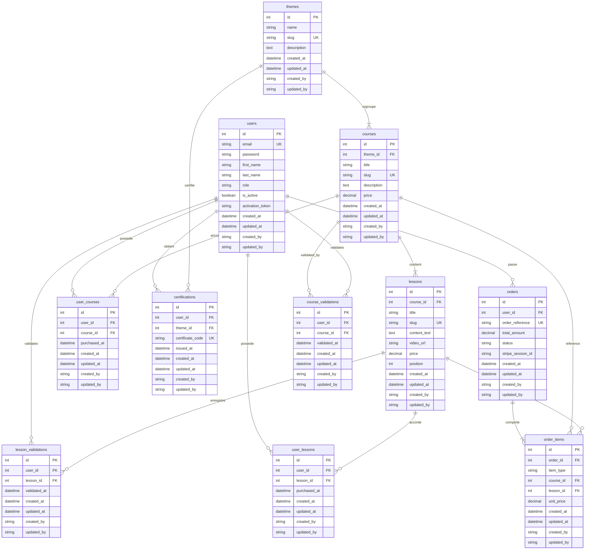

# Modèle Physique de Données (MPD) - Knowledge Learning

Ce document présente la structure relationnelle de la base de données MySQL du projet **Knowledge Learning** (10 tables normalisées avec contraintes d'intégrité référentielle, index d'unicité et traçabilité complète).

---

## 1. Diagramme Entité-Relation (Mermaid)

---

## 2. Description des 10 Tables et Justification Métier

1. **`users`** : Stocke les apprenants et administrateurs. Mots de passe hachés (`Argon2id` / `Bcrypt`), rôle par défaut `ROLE_CLIENT`, compte inactif jusqu'à activation par mail (`activation_token`).
2. **`themes`** : Catégories principales de formation (Musique, Informatique, Jardinage, Cuisine).
3. **`courses`** : Cursus complets rattachés à un thème, avec prix et identifiant d'URL unique (`slug`).
4. **`lessons`** : Fiches de cours et vidéos intégrant lecteur sécurisé et prix individuel.
5. **`orders`** : Commandes e-commerce créées avant paiement (`pending`) puis validées par webhook Stripe (`paid`).
6. **`order_items`** : Lignes d'articles rattachées à la commande (cursus ou leçons) avec prix unitaire figé à l'achat.
7. **`user_courses`** : Droits d'accès acquis par l'apprenant pour un cursus complet (contrainte `UNIQUE(user_id, course_id)`).
8. **`user_lessons`** : Droits d'accès acquis par l'apprenant pour une leçon individuelle achetée à l'unité.
9. **`lesson_validations`** : Historique des validations d'étapes d'apprentissage par leçon.
10. **`course_validations`** : Cursus validé quand toutes ses leçons sont validées (contrainte `UNIQUE(user_id, course_id)`).
11. **`certifications`** : Attestation par thème, délivrée quand toutes les leçons du thème sont validées, avec un code d'authenticité unique (`KL-CERT-YYYY-XXXX`).

---

## 3. Conformité aux Exigences du Jury
- **Traçabilité complète** : Toutes les tables comportent systématiquement `created_at`, `updated_at`, `created_by` et `updated_by`.
- **Intégrité référentielle** : Clés étrangères (`FOREIGN KEY`) avec clauses adaptées (`ON DELETE CASCADE` ou `SET NULL`).
- **Index d'unicité** : Prévention native des doublons sur les emails, références de commande et certifications.
